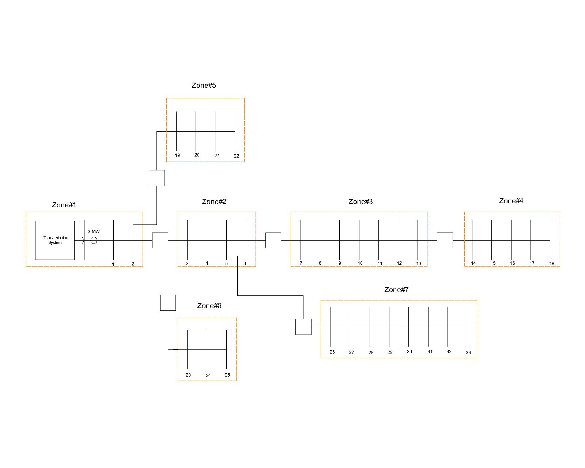
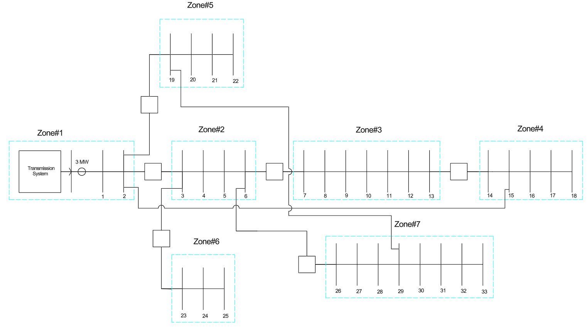
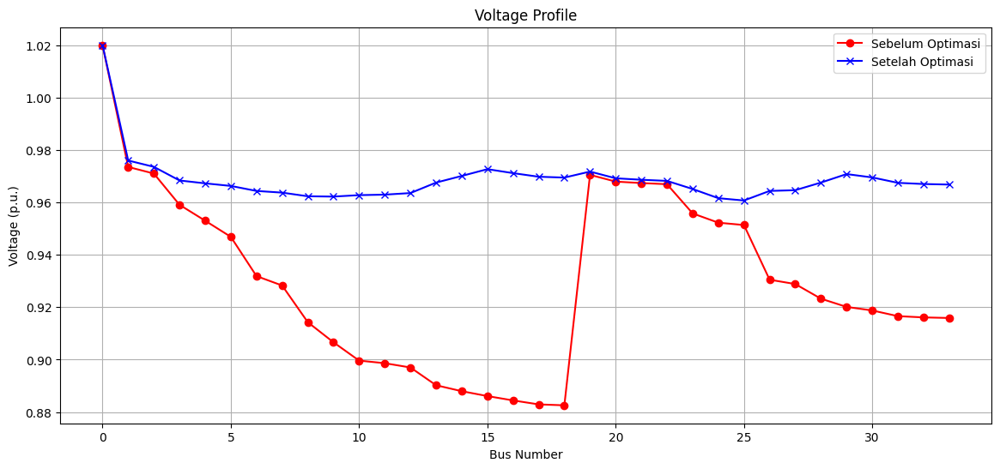
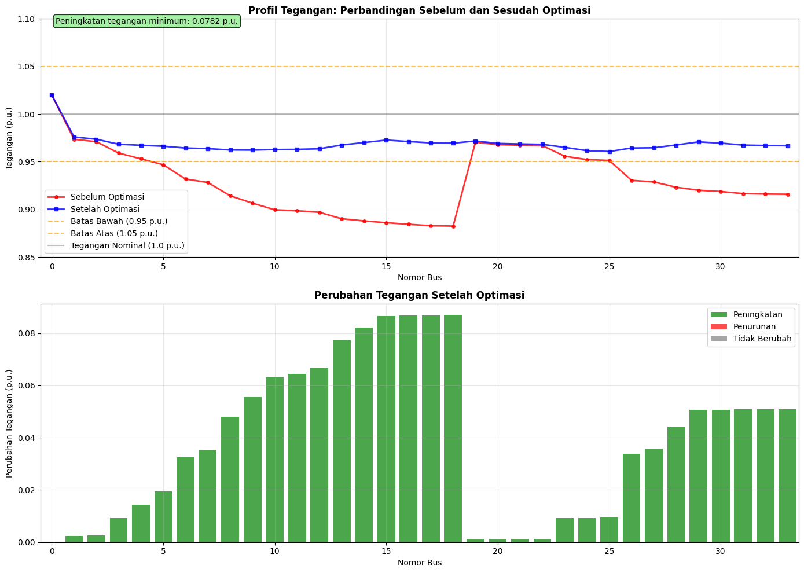

# IEEE 33-Bus Distribution Network Load Flow Simulation and Optimization Using Pandapower


This repository contains a load flow analysis and distribution network reconfiguration simulation of the standard **IEEE 33-Bus** test system, incorporating additional tie-lines using the Python library **Pandapower**. This project was developed as the final project report for the **Computer Programming** course in the Applied Bachelor's Degree Program in Electrical Engineering Technology (TRE), Vocational College, Universitas Gadjah Mada.

---

## Background & Objectives

The standard IEEE 33-Bus radial distribution network often experiences significant voltage drops at buses located at the ends of its feeder branches (such as Buses 18, 22, 25, and 33). These conditions can negatively affect power quality and the reliability of the electrical distribution system.

The main objectives of this project are:

1. To computationally model the IEEE 33-Bus electrical power system using the **Pandapower** library.
2. To perform a load flow simulation before optimization and identify buses experiencing under-voltage conditions.
3. To implement a network reconfiguration scenario by adding **tie-lines** at strategic locations (Lines 2-15 and 19-29).
4. To analyze improvements in the system voltage profile and calculate voltage deviation reduction using the **Root Mean Square Error (RMSE)** metric against a reference voltage of $1.02\text{ pu}$.

---

## Single Line Diagram

### 1. Single Line Diagram Before Optimization

Under the initial operating condition (radial configuration without additional tie-lines), buses located at the ends of lateral feeders experience the greatest voltage drops due to cumulative line impedance and loading conditions.



### 2. Single Line Diagram After Optimization

By adding tie-lines between **Bus 2 and Bus 15**, and **Bus 19 and Bus 29**, power can flow through alternative paths, significantly reducing the equivalent impedance supplying heavily loaded buses.



---

## Methodology & Program Overview

The system model is developed through several stages using Python and the `pandapower` library:

```text
                 ┌────────────────────────────────┐
                 │   Initialize Empty Network     │
                 │     pp.create_empty_network    │
                 └───────────────┬────────────────┘
                                 │
                 ┌───────────────▼────────────────┐
                 │   Define Buses & External Grid │
                 │ 132 kV Grid, 12.66 kV Buses    │
                 └───────────────┬────────────────┘
                                 │
                 ┌───────────────▼────────────────┐
                 │      Step-Down Transformer     │
                 │ 132 kV / 12.66 kV, 40 MVA      │
                 └───────────────┬────────────────┘
                                 │
                 ┌───────────────▼────────────────┐
                 │       Define Transmission     │
                 │       Lines (R, X, Current)    │
                 └───────────────┬────────────────┘
                                 │
                 ┌───────────────▼────────────────┐
                 │        Define Loads            │
                 │      P (MW) & Q (MVAR)         │
                 └───────────────┬────────────────┘
                                 │
                 ┌───────────────▼────────────────┐
                 │       Load Flow Analysis       │
                 │          pp.runpp(net)         │
                 └───────────────┬────────────────┘
                                 │
                 ┌───────────────▼────────────────┐
                 │   Voltage Profile & RMSE       │
                 │          Analysis              │
                 └────────────────────────────────┘
```

1. **Bus and External Grid Configuration:**
   - The external grid is connected to Bus 0 with a source voltage of $V_{\text{ext}} = 1.02\text{ pu}$ at the $132\text{ kV}$ voltage level.
   - Buses 1 to 33 are defined at a nominal voltage level of $12.66\text{ kV}$.

2. **Power Transformer:**
   - Connects Bus 0 ($132\text{ kV}$) to Bus 1 ($12.66\text{ kV}$) with a rated capacity of $40\text{ MVA}$.

3. **Load Allocation:**
   - Each bus is assigned active power ($P$) and reactive power ($Q$) loads based on the standard IEEE 33-Bus test system data ($Q = P \times \tan \theta$, where $\tan \theta \approx 0.618$).

4. **Line and Tie-Line Configuration:**
   - Resistive ($R$) and reactive ($X$) impedance parameters per kilometer are defined using the `pp.create_line_from_parameters` function.
   - In the post-optimization network (`net2`), two additional interconnection lines (*tie-lines*) are introduced:
     - Bus 2 – Bus 15
     - Bus 19 – Bus 29

5. **Load Flow Execution:**
   - The simulation is performed using the Newton-Raphson algorithm through the `pp.runpp(net)` function.

---

## Simulation Results and Analysis

### 1. Voltage Profile Comparison

The following graph illustrates the voltage profile comparison between the pre-optimization condition (red line) and the post-optimization condition (blue line):



### 2. Bus Voltage Improvement Analysis

The impact of adding tie-lines on voltage magnitude improvements across individual buses in the distribution network:



### 3. Quantitative Voltage Deviation Evaluation (RMSE)

The voltage profile quality is evaluated using the *Root Mean Square Error* (RMSE) metric against the reference voltage of $V_{\text{ref}} = 1.02\text{ pu}$:

$$
\text{RMSE} = \sqrt{\frac{1}{N} \sum_{i=1}^{N} \left(V_{i} - V_{\text{ref}}\right)^{2}}
$$

| Network Condition | RMSE Value (p.u.) | Description |
|---|---|---|
| **Before Optimization (`net1`)** | **0.09599** | Significant voltage drops occur at downstream buses |
| **After Optimization (`net2`)** | **0.05213** | Voltage profile improves and approaches the reference voltage |
| **Improvement Percentage** | **~45.7%** | Significant reduction in voltage deviation |

**Conclusion:** The addition of tie-lines demonstrates significant potential for improving the voltage profile of the distribution network. The reconfigured system exhibits reduced voltage deviations and improved power transfer capabilities through alternative distribution paths.

---

## Repository Structure

```text
pandapower-ieee33/
├── README.md                                          # Technical documentation and analysis
├── .gitignore                                         # Python cache and Jupyter checkpoint exclusions
├── notebooks/
│   └── ieee33-pandapower-optimization.ipynb           # Complete Jupyter Notebook with simulations and plots
└── assets/
    └── images/
        ├── sld-sebelum-optimasi.jpg                   # Initial network single line diagram
        ├── sld-setelah-optimasi.jpg                   # Network single line diagram with tie-lines
        ├── perbandingan-profil-tegangan.png           # Bus voltage profile comparison
        └── analisis-profil-dan-perubahan-tegangan.png # Voltage profile and deviation analysis
```

---

## How to Run the Project

### 1. System Requirements (Prerequisites)

Make sure Python version 3.8 or later is installed on your system.

### 2. Install Dependencies

Install the required Python libraries using the terminal:

```bash
pip install pandapower matplotlib pandas numpy jupyter
```

### 3. Run the Jupyter Notebook

Launch Jupyter Notebook and open the simulation file:

```bash
jupyter notebook notebooks/ieee33-pandapower-optimization.ipynb
```

Alternatively, the notebook can be executed using Google Colab through the corresponding notebook link.

---

## License & Copyright

This project was developed for academic and research purposes as part of the Applied Bachelor's Degree Program in Electrical Engineering Technology, Vocational College, Universitas Gadjah Mada.
